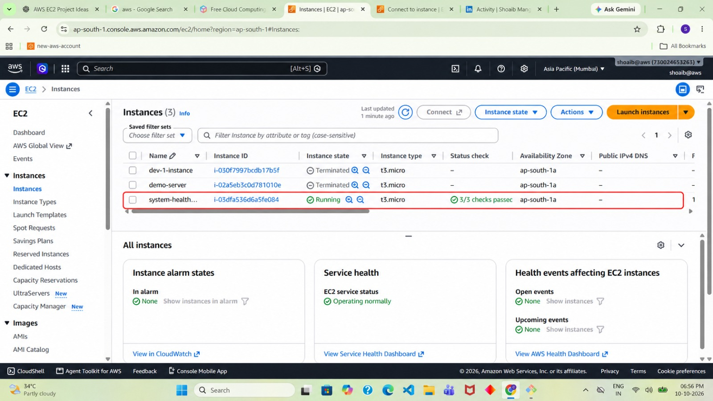
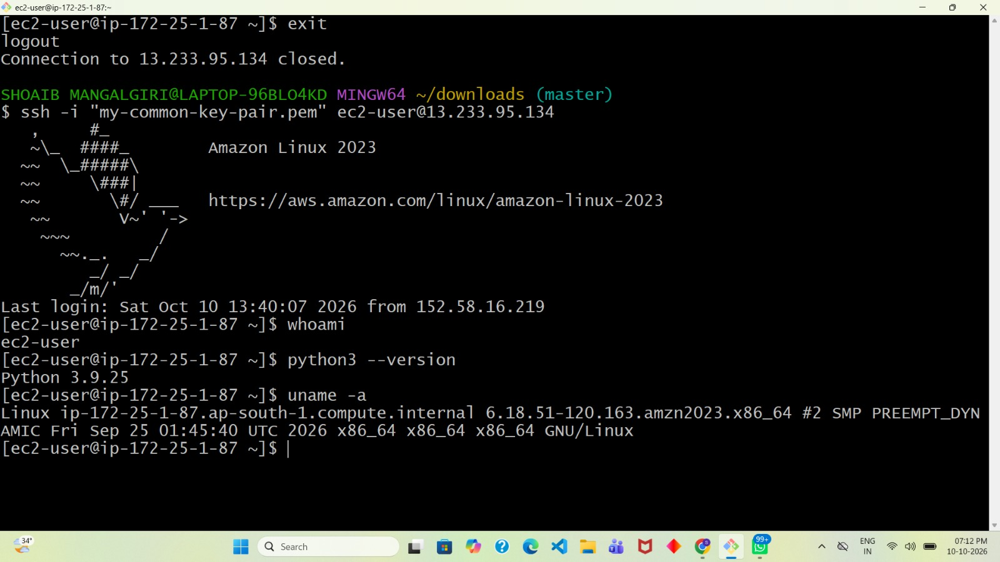
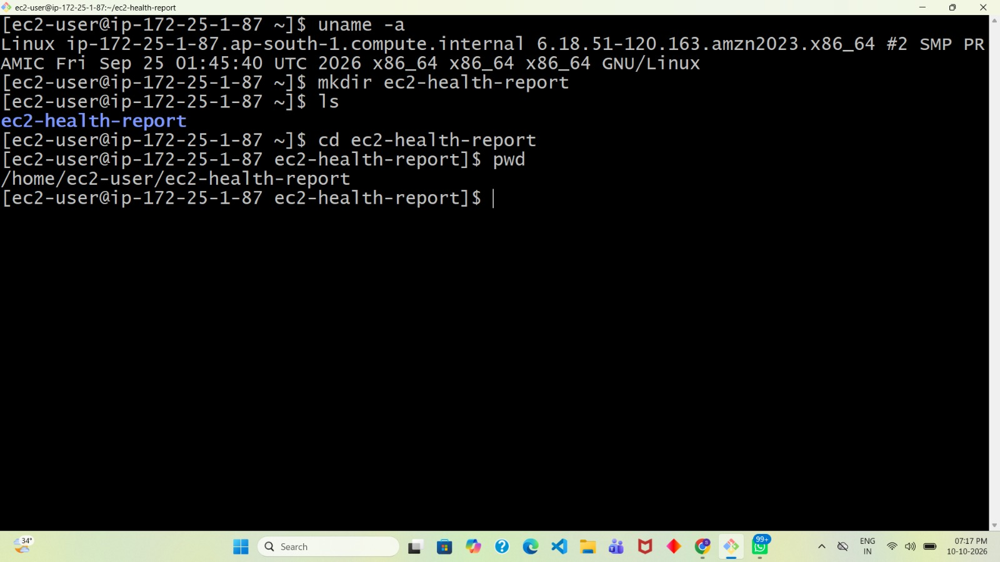
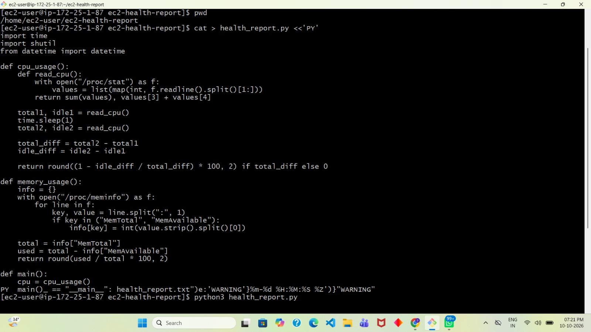
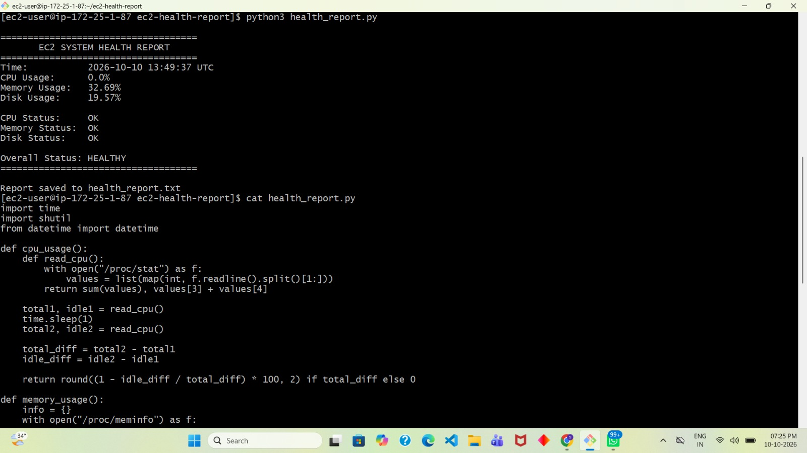
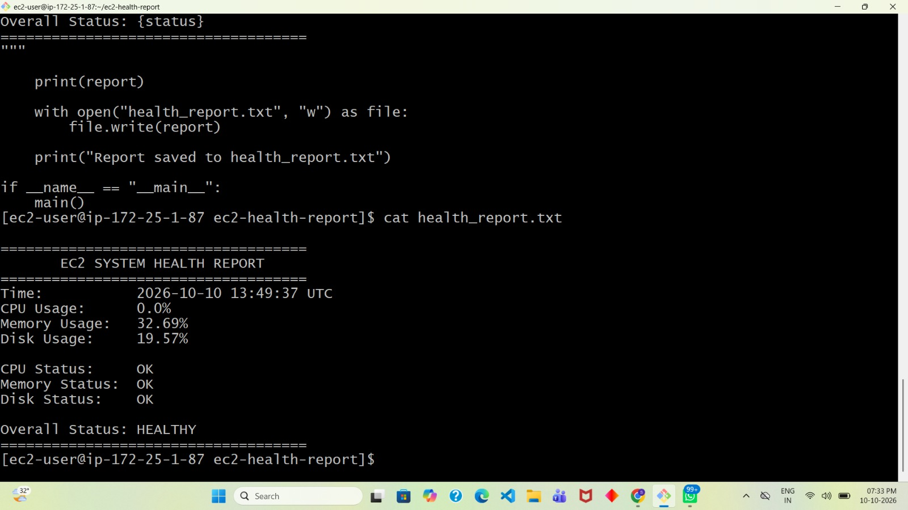

# EC2 System Health Report Using Python & AWS

## Project Overview
This project demonstrates basic system health monitoring on an Amazon EC2 instance running Amazon Linux 2023. A Python script collects CPU, memory, and disk usage information, evaluates system health, and generates a text-based health report.

## Technologies Used
- AWS EC2
- Amazon Linux 2023
- Python 3
- Linux commands

## Features
- CPU utilization monitoring
- Memory usage monitoring
- Disk usage monitoring
- HEALTHY/WARNING status evaluation
- Report generation in `health_report.txt`

## Project Structure
```text
EC2-System-Health-Report-Using-Python/
├── health_report.py
├── health_report.txt
├── screenshots/
└── README.md
```

## How to Run
1. Connect to an Amazon Linux EC2 instance.
2. Verify that Python 3 is installed.
3. Run the script:

```bash
python3 health_report.py
```

4. View the generated report:

```bash
cat health_report.txt
```

## Sample Output
```text
EC2 SYSTEM HEALTH REPORT

CPU Usage: 0.0%
Memory Usage: 32.69%
Disk Usage: 19.57%

CPU Status: OK
Memory Status: OK
Disk Status: OK

Overall Status: HEALTHY
```

*Note: Usage values vary depending on the instance's current workload.*

## Learning Outcomes
- Practiced connecting to and managing an EC2 Linux instance.
- Used Python to collect system resource metrics.
- Practiced Linux commands and file handling.
- Generated a basic system health report.

## Future Improvements
- Schedule periodic checks using cron.
- Add logging and email alerts.
- Integrate monitoring with Amazon CloudWatch.

## Author
Shoaib Mangalgiri
## Project Screenshots

### 1. EC2 Instance Running


### 2. SSH Connection to Amazon Linux


### 3. EC2 Project Directory


### 4. Python Health Script


### 5. Health Report Execution


### 6. Generated Health Report



[GitHub Profile](https://github.com/shoaib492)
